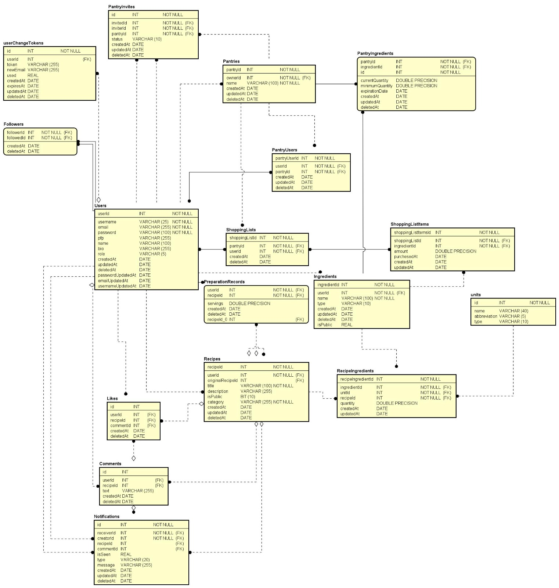

<table>
  <tr>
    <td>
      
    </td>
    <td>
      <strong>Diagrama Entidade-Relacionamento (ER)</strong>
      

        Representação visual da estrutura do banco de dados,
        apresentando suas entidades, atributos e relacionamentos.
      

      

        <em>A imagem é clicável! Clique nela para abri-la em tamanho
        original e visualizar os detalhes com mais facilidade.</em>
      

    </td>
  </tr>
</table>
